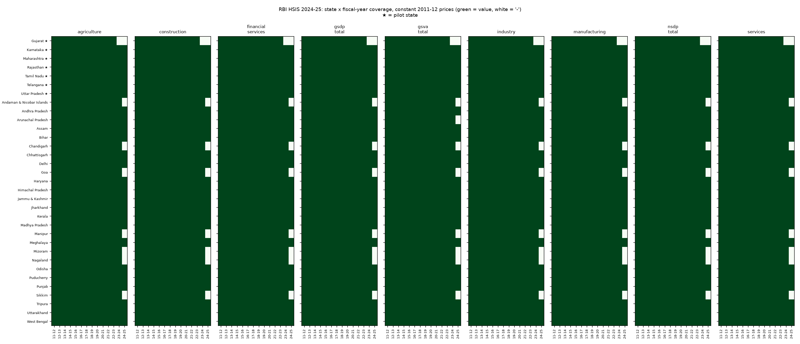

# Validation: RBI HSIS 2024-25 panel
Source files: 47 raw tables in `data/raw/rbi_hsis/2025-12-11/` (official HTML pages; XLSX blocked by a browser check).

## Duplicates
- fact_economic: 0
- fact_indicator_rbi: 0

## Price bases
- fact_economic bases: ['2011-12'] (must be exactly ['2011-12'])
- quarantined cells with another base: 0

## Missingness
- 4158 cells, 82 missing ('-' in source).
- Pilot-state gaps:
  - Gujarat 2023-24: agriculture, construction, financial_services, gsdp_total, gsva_total, industry, manufacturing, nsdp_total, services
  - Gujarat 2024-25: agriculture, construction, financial_services, gsdp_total, gsva_total, industry, manufacturing, nsdp_total, services
- Most gaps (all states): Gujarat 18, Andaman & Nicobar Islands 9, Chandigarh 9, Goa 9, Manipur 9, Mizoram 9, Nagaland 9, Sikkim 9, Arunachal Pradesh 1

## Non-positive value added
- 0 cells

## Year-on-year change beyond +-40% (flagged, kept)
- 35 flags in all states; pilot-state flags:
  - Telangana agriculture 2019-20: +55.4%
  - Uttar Pradesh manufacturing 2016-17: +47.0%
- Geography breaks: Jammu & Kashmir 2019-20 (J&K excludes Ladakh from 2019-20) -> growth for that year is not used as a target.

## Fixture: manufacturing GSVA, 2023 edition vs 2024-25 edition (pilot states)
- 82 comparable cells; 19 differ (edition revisions), 0 parsing bugs.

| State | FY | 2023 ed. | 2024-25 ed. | diff | classification |
|---|---|---:|---:|---:|---|
| Karnataka | 2019-20 | 16,972,251 | 16,967,696 | -0.0% | edition revision (parsed value matches raw file) |
| Maharashtra | 2019-20 | 34,727,723 | 34,719,569 | -0.0% | edition revision (parsed value matches raw file) |
| Karnataka | 2020-21 | 16,481,847 | 16,797,862 | +1.9% | edition revision (parsed value matches raw file) |
| Maharashtra | 2020-21 | 32,742,561 | 32,450,485 | -0.9% | edition revision (parsed value matches raw file) |
| Rajasthan | 2020-21 | 8,881,279 | 9,193,769 | +3.5% | edition revision (parsed value matches raw file) |
| Telangana | 2020-21 | 8,315,447 | 8,315,691 | +0.0% | edition revision (parsed value matches raw file) |
| Uttar Pradesh | 2020-21 | 15,283,113 | 15,283,535 | +0.0% | edition revision (parsed value matches raw file) |
| Gujarat | 2021-22 | 43,722,492 | 42,954,292 | -1.8% | edition revision (parsed value matches raw file) |
| Karnataka | 2021-22 | 18,313,224 | 19,660,672 | +7.4% | edition revision (parsed value matches raw file) |
| Maharashtra | 2021-22 | 34,115,536 | 36,030,728 | +5.6% | edition revision (parsed value matches raw file) |
| Rajasthan | 2021-22 | 9,949,970 | 10,278,293 | +3.3% | edition revision (parsed value matches raw file) |
| Tamil Nadu | 2021-22 | 29,039,850 | 28,935,008 | -0.4% | edition revision (parsed value matches raw file) |
| Telangana | 2021-22 | 9,400,646 | 8,376,100 | -10.9% | edition revision (parsed value matches raw file) |
| Uttar Pradesh | 2021-22 | 16,881,077 | 17,101,511 | +1.3% | edition revision (parsed value matches raw file) |
| Gujarat | 2022-23 | - | 44,015,190 | | now published (was not available in 2023 edition) |
| Karnataka | 2022-23 | 19,206,541 | 19,929,138 | +3.8% | edition revision (parsed value matches raw file) |
| Maharashtra | 2022-23 | - | 35,494,651 | | now published (was not available in 2023 edition) |
| Rajasthan | 2022-23 | 10,446,068 | 10,648,343 | +1.9% | edition revision (parsed value matches raw file) |
| Tamil Nadu | 2022-23 | 32,060,839 | 29,175,436 | -9.0% | edition revision (parsed value matches raw file) |
| Telangana | 2022-23 | 9,823,218 | 7,851,600 | -20.1% | edition revision (parsed value matches raw file) |
| Uttar Pradesh | 2022-23 | 19,495,092 | 16,970,929 | -12.9% | edition revision (parsed value matches raw file) |

## Research extract (data/extracted) vs raw-file parse
- 2772 cells compared, 2 differ. The raw file is the source of record; differences are transcription errors in the extract:
  - gsva_total Tamil Nadu 2018-19: extract 103,017,170 vs raw 108,017,170
  - services Rajasthan 2018-19: extract 26,784,901 vs raw 27,784,901

## Identities
- industry >= manufacturing + construction: 0 violations
- (agriculture + industry + services) / total GSVA: median 0.932, range 0.745-0.998. RBI's 'agriculture' table is crop+livestock+forestry+fishing as published; the gap is not used anywhere.

## Coverage heatmap

